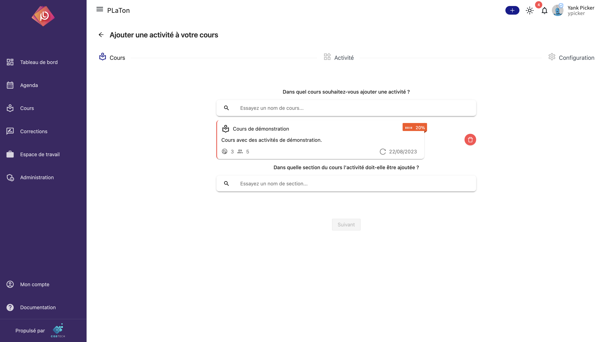

import { Callout } from 'nextra/components'

# Ajouter des activités dans un cours

Cette page est en cours de construction

## Recharger une activité

Lorsqu'une nouvelle version d'une activité ou de ses exercices est publiée, le bouton **Recharger** des paramètres de l'activité
permet de mettre à jour l'activité du cours sans perdre le travail déjà fait par les élèves.

Une fenêtre compare les exercices de l'activité avec la dernière version publiée et indique pour chacun s'il est
**inchangé**, **modifié**, **ajouté** ou **retiré**, ainsi que le nombre d'élèves qui y ont déjà répondu. Il est possible de
recharger tous les exercices qui ont changé, ou de choisir ceux à recharger.

- Les copies des exercices **inchangés** sont conservées : réponses, notes et corrections.
- Les copies des exercices **modifiés** ou **retirés** que vous rechargez sont effacées : les élèves recommencent l'exercice.
- Les exercices **ajoutés** apparaissent dans l'activité de chaque élève. Une activité déjà terminée est rouverte.
- Un exercice modifié que vous ne rechargez pas garde son ancienne version. Il sera proposé de nouveau au prochain rechargement.
- La note de l'activité est recalculée en tenant compte des corrections des enseignants.

### Recharger en gardant les réponses

Dans la vue **Choisir les exercices**, chaque exercice modifié peut être rechargé en cochant **Garder les réponses des
élèves**. Dans ce cas, aucune copie n'est effacée :

- seules les variables modifiées par la nouvelle version (affichées sous l'exercice) sont mises à jour dans les copies
  des élèves ;
- une variable que l'exercice de l'élève a déjà modifiée (calculée par le `builder`, changée par une réponse…) est conservée
  telle quelle ;
- les réponses des élèves ne sont **jamais** modifiées : en les consultant, on voit l'exercice tel qu'il était au moment
  de la réponse ;
- les notes et les tentatives ne sont pas recalculées.

<Callout type="warning">
  À utiliser uniquement pour une correction de forme : une faute dans l'énoncé, le nom de l'exercice… Si la modification
  touche la solution ou la correction, les notes déjà données ne correspondent plus au nouvel exercice. La fenêtre
  prévient lorsque le `builder`, le `grader` ou les fichiers inclus ont changé.
</Callout>

<Callout type="warning">
  Dans une activité en mode « évaluation par les pairs », les exercices ne peuvent pas être rechargés séparément : si un
  exercice a changé, les copies de **tous** les exercices sont effacées.
</Callout>

### Limites connues

Le rechargement conserve au mieux le travail des élèves, mais quelques cas ne sont pas gérés parfaitement :

- **Élève en cours de réponse** : si un élève répond pendant le rechargement, l'état de l'exercice dans sa navigation
  peut revenir en arrière. Sa réponse et sa note sur l'exercice sont conservées. Il est préférable de recharger quand
  l'activité est peu utilisée.
- **Même exercice présent plusieurs fois** : les exercices sont reconnus par leur ressource, puis par leur contenu, puis
  par leur ordre. Si un exercice présent plusieurs fois est à la fois déplacé et modifié, les copies peuvent être
  attribuées à la mauvaise occurrence.
- **Activités avec un script `next`** : les données du script (variables sauvegardées, historique, exercices générés)
  ne sont pas nettoyées et peuvent encore faire référence à un exercice retiré. La note calculée par le script est conservée.
- **Exercice retiré non rechargé** : il reste dans l'activité, mais il est placé à la fin de son groupe.
- **Ressource seulement renommée** : le nom de la ressource ne fait pas partie du contenu comparé, l'exercice reste donc
  affiché comme inchangé. Le libellé dans la navigation des élèves n'est mis à jour que lorsque l'exercice est rechargé
  pour une autre raison.
- **Note de 100 après rechargement** : si la note de l'activité atteint 100 à cause du rechargement (par exemple parce
  qu'un exercice raté a été retiré), la date de réussite n'est pas renseignée.
- **Garder les réponses** : un `builder` ou un `grader` modifié s'applique aux prochaines réponses, mais l'environnement
  déjà construit pour l'élève n'est pas reconstruit : un nouveau fichier inclus peut ne pas être disponible pour le
  `grader` avant un nouveau tirage de l'exercice. Les composants sont comparés en entier : si l'élève a déjà répondu,
  un composant modifié n'est pas mis à jour.
- **Nombre d'élèves affiché** : il compte aussi les membres de test du cours.
- **Échec du rechargement** : si la mise à jour des copies échoue, rien n'est modifié et un message d'erreur s'affiche ; le
  rechargement peut être relancé.
