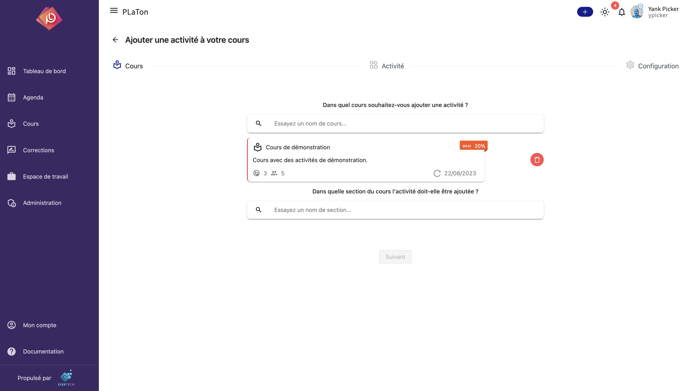

import { Callout, Steps } from 'nextra/components'

# Ajouter et paramétrer des activités

Une activité de cours est une [activité](/main/resources/activities) de l'espace de travail publiée dans une section
du cours. Chaque activité de cours a ses **propres** dates, règles d'accès et paramètres : la même ressource peut être
utilisée dans plusieurs cours avec des réglages différents.

## Ajouter une activité

Le bouton **Ajouter une activité** se trouve dans le menu d'une section (voir
[Sections](/main/courses/sections)) ou en haut de la vue tableau du cours. Il ouvre un assistant en quatre étapes.

<Steps>

### Section

Choisissez la section du cours dans laquelle ajouter l'activité. Cette étape est déjà remplie si vous êtes parti du
menu d'une section.

### Activité

Recherchez l'activité dans l'espace de travail (barre de recherche et filtres par cercle, thème, niveau,
auteur…). Vous pouvez **sélectionner plusieurs activités** : elles seront toutes ajoutées avec les mêmes réglages. Le
bandeau en haut de la liste rappelle la sélection ; **Tout désélectionner** la vide et **Suivant** passe à l'étape
suivante.

### Fonction

Choisissez le type d'activité ; les étapes suivantes s'adaptent à ce choix.

| Fonction                 | Usage                                                                                                                         |
| ------------------------ | ----------------------------------------------------------------------------------------------------------------------------- |
| **Entraînement**         | Activité simple, sans réglage particulier, pour que les élèves s'entraînent librement.                                       |
| **TP noté / Examen**     | Activité évaluée : durée maximale, nombre de tentatives, sécurité anti-triche et correction par les enseignants (voir plus bas). |
| **Challenge**            | Activité dont le classement est visible par tous les membres du cours (voir [Challenges](/main/courses/challenges)).        |

### Configuration

- **Cacher aux étudiants** : l'activité est ajoutée masquée ; il faudra la réafficher manuellement.
- **Dates d'ouverture et de fermeture** (facultatives) : en dehors de cette plage, les étudiants voient l'activité
  mais ne peuvent pas la lancer.
- Pour un **TP noté / Examen**, les paramètres de l'examen décrits ci-dessous.

Cliquez sur **Créer** : vous revenez au cours, sur la carte de la nouvelle activité.

</Steps>

<Callout type="info">
  L'activité ajoutée est la dernière version (`latest`) de la ressource au moment de l'ajout. Si vous modifiez ensuite
  l'activité ou ses exercices, utilisez [Recharger](#recharger-une-activité) pour mettre à jour le cours.
</Callout>

### Paramètres d'un TP noté

Pour la fonction **TP noté / Examen**, les boutons **Aides**, **Théories**, **Solution** et **Autre question** sont
automatiquement désactivés, et un cadre **Paramètres de l'examen** apparaît :

| Paramètre                          | Effet                                                                                                                                                                    |
| ---------------------------------- | ------------------------------------------------------------------------------------------------------------------------------------------------------------------------ |
| **Durée maximale**                 | Temps dont dispose chaque étudiant à partir du moment où il démarre l'activité (heures, minutes, secondes). 0 = durée illimitée.                                          |
| **Tentatives maximales**           | Nombre maximal de validations par exercice. 0 = illimité.                                                                                                                |
| **Code de déblocage**              | Code de 6 caractères généré automatiquement (bouton pour en générer un autre). Il permet à un étudiant de reprendre l'activité après un arrêt dû aux règles de sécurité. |
| **Désactiver copier-coller**       | Interdit le copier-coller dans l'activité (coché par défaut).                                                                                                           |
| **Terminer si changement d'onglet**| Termine l'activité si l'étudiant quitte la page (changement d'onglet ou de fenêtre). Coché par défaut.                                                                  |
| **Terminer si perte de focus**     | Termine l'activité si la page perd le focus (clic en dehors de la page, autre fenêtre…). Coché par défaut.                                                              |

Tous les membres du cours qui ont un compte **enseignant** deviennent automatiquement les **correcteurs** de
l'activité : les copies leur sont attribuées dans l'espace [Corrections](/main/courses/corrections). La liste des
correcteurs se modifie ensuite dans les [périodes d'accès](#onglet-restrictions).

#### Arrêt et déblocage côté étudiant

Quand une règle de sécurité est enfreinte, l'activité de l'étudiant est **terminée** et un message lui en indique la
raison. Un cadre **Code de déblocage** lui demande alors de saisir le code que l'enseignant lui communique : un code
correct rouvre sa session et il peut reprendre là où il en était.

L'enseignant retrouve le code (masqué, à révéler d'un clic) dans la page de [suivi de l'activité](/main/courses/monitoring),
où il peut aussi le régénérer : l'ancien code cesse alors de fonctionner.

## Les actions d'une carte d'activité

| Bouton / menu                         | Visible par                 | Effet                                                                                       |
| ------------------------------------- | --------------------------- | ------------------------------------------------------------------------------------------- |
| **Lancer** / **Voir mes résultats**   | Membres du cours            | Ouvre l'activité dans un nouvel onglet ; une fois l'activité fermée, affiche les résultats. |
| **Editer**                            | Membres ayant accès à la ressource | Ouvre la ressource de l'activité dans l'éditeur.                                      |
| ⋮ › **Suivi de l'activité**           | Enseignants                 | Suivi en direct et modération (voir [Suivi en direct](/main/courses/monitoring)).           |
| ⋮ › **Statistiques**                  | Enseignants                 | Résultats détaillés (voir [Statistiques](/main/courses/statistics)).                        |
| ⋮ › **Télécharger les notes au format CSV** | Enseignants           | Export des notes de cette activité (voir [Téléchargement des notes](/main/courses/grades-csv)). |
| ⋮ › **Ouvrir la ressource associée**  | Membres ayant accès à la ressource | Page de la ressource dans l'espace de travail.                                       |
| ⋮ › **Partager**                      | Enseignants                 | Affiche le lien direct vers l'activité et son QR code.                                      |
| ⋮ › **Paramètres**                    | Enseignants                 | Ouvre le panneau de paramètres décrit ci-dessous.                                           |

La carte affiche aussi l'avancement de l'utilisateur sur les exercices et les dates d'ouverture et de fermeture.
Une activité cachée porte la mention **Caché aux étudiants**.

## Paramétrer une activité

Le panneau **Paramètres** d'une activité comporte trois onglets. Les modifications ne sont prises en compte qu'après
enregistrement.

### Onglet Restrictions

Cet onglet définit **qui a accès à l'activité, et quand**.

Le bouton **Cacher aux étudiants** / **Montrer aux étudiants** masque ou réaffiche l'activité.

Par défaut, une activité suit ses **dates d'ouverture et de fermeture**, identiques pour tous les membres du cours :
cliquez sur une date pour la modifier.

Pour donner des dates différentes selon les étudiants (groupes de TP, tiers-temps, rattrapage…), créez des
**périodes d'accès** avec **Créer la première période d'accès**, puis **Ajouter une nouvelle période d'accès**. Chaque
période combine :

| Critère                       | Rôle                                                                                                                                         |
| ----------------------------- | -------------------------------------------------------------------------------------------------------------------------------------------- |
| **Période temporelle**        | Dates d'ouverture et de fermeture de la période.                                                                                             |
| **Utilisateurs spécifiques**  | Membres du cours concernés par la période.                                                                                                   |
| **Groupes spécifiques**       | [Groupes du cours](/main/courses/groups) concernés.                                                                                          |
| **Correcteurs**               | Membres qui ont accès pendant la période **et** qui deviennent correcteurs de l'activité. Sans correcteur, l'activité est auto-corrigée.     |
| **Tous les autres**           | Tous les membres qui ne sont concernés par aucune autre période.                                                                              |

Les règles d'attribution sont les suivantes :

1. Les périodes sont examinées **dans l'ordre affiché** (réorganisable par glisser-déposer) ; un étudiant obtient les
   dates de la **première** période qui le concerne (utilisateur, groupe ou correcteur de la période).
2. Si aucune période ne le concerne, il obtient les dates de la période **Tous les autres**.
3. S'il n'existe pas de période **Tous les autres**, il n'a **pas accès** à l'activité.

<Callout type="warning">
  Créer la première période d'accès remplace les dates communes : seuls les utilisateurs et groupes indiqués dans des
  périodes gardent l'accès. Ajoutez une période **Tous les autres** pour conserver l'accès du reste du cours.
</Callout>

### Onglet Paramètres

Ces réglages sont repris de la [configuration de l'activité](/main/programing/activity/config) et peuvent être
modifiés pour ce cours uniquement.

| Rubrique       | Réglage                                       | Effet                                                                                                  |
| -------------- | --------------------------------------------- | ------------------------------------------------------------------------------------------------------ |
| **Temps**      | Durée                                         | Durée maximale d'une session, à partir de son démarrage.                                               |
| **Aléatoire**  | Seed aléatoire par exercice                   | Chaque exercice reçoit sa propre graine aléatoire au lieu de partager celle de l'activité.             |
| **Actions**    | Tentatives maximales                          | Nombre maximal de validations par exercice (0 = illimité).                                             |
|                | Afficher le bouton « Aides »                  | Autorise l'affichage des indices.                                                                       |
|                | Afficher le bouton « Autre question »         | Autorise l'apprenant à tirer une nouvelle version de l'exercice.                                       |
|                | Afficher le bouton « Théories »               | Autorise l'accès aux documents de théorie des exercices.                                               |
|                | Afficher le bouton « Solution »               | Autorise l'affichage de la solution.                                                                   |
| **Feedback**   | Feedback de validation                        | Affiche un retour après chaque validation.                                                             |
|                | Révision des exercices                        | Permet de revoir les exercices et leurs retours après la fin de l'activité.                           |
| **Sécurité**   | Désactiver copier-coller, Terminer si changement d'onglet, Terminer si perte de focus | Voir les [paramètres d'un TP noté](#paramètres-dun-tp-noté). |

### Onglet Gestion

- **Apparence de l'activité** : couleur de la carte dans le cours.
- **Fermer l'activité** : les étudiants ne peuvent plus y accéder. La date de fermeture de l'activité **et de toutes
  ses périodes d'accès** est fixée à l'instant présent.
- **Rouvrir pour tous** : supprime la date de fin de l'activité **et de toutes ses périodes d'accès** ; si aucune
  période ne concerne « Tous les autres », une telle période est ajoutée pour rouvrir l'activité à tout le cours.
- **Recharger** : met à jour l'activité avec la dernière version de la ressource (voir ci-dessous).
- **Supprimer** : retire l'activité du cours (irréversible).

<Callout type="warning">
  **Fermer** puis **Rouvrir** ne restaure pas les dates de fin d'origine des périodes d'accès : elles sont
  supprimées. Pensez à les redéfinir si nécessaire.
</Callout>

## Recharger une activité

Lorsqu'une nouvelle version d'une activité ou de ses exercices est publiée, le bouton **Recharger** des paramètres de l'activité
permet de mettre à jour l'activité du cours sans perdre le travail déjà fait par les élèves.

Une fenêtre compare les exercices de l'activité avec la dernière version publiée et indique pour chacun s'il est
**inchangé**, **modifié**, **ajouté** ou **retiré**, ainsi que le nombre d'élèves qui y ont déjà répondu. Il est possible de
recharger tous les exercices qui ont changé, ou de choisir ceux à recharger.

- Les copies des exercices **inchangés** sont conservées : réponses, notes et corrections.
- Les copies des exercices **modifiés** ou **retirés** que vous rechargez sont effacées : les élèves recommencent l'exercice.
- Les exercices **ajoutés** apparaissent dans l'activité de chaque élève. Une activité déjà terminée est rouverte.
- Un exercice modifié que vous ne rechargez pas garde son ancienne version. Il sera proposé de nouveau au prochain rechargement.
- La note de l'activité est recalculée en tenant compte des corrections des enseignants.

### Recharger en gardant les réponses

Dans la vue **Choisir les exercices**, chaque exercice modifié peut être rechargé en cochant **Garder les réponses des
élèves**. Dans ce cas, aucune copie n'est effacée :

- seules les variables modifiées par la nouvelle version (affichées sous l'exercice) sont mises à jour dans les copies
  des élèves ;
- une variable que l'exercice de l'élève a déjà modifiée (calculée par le `builder`, changée par une réponse…) est conservée
  telle quelle ;
- les réponses des élèves ne sont **jamais** modifiées : en les consultant, on voit l'exercice tel qu'il était au moment
  de la réponse ;
- les notes et les tentatives ne sont pas recalculées.

<Callout type="warning">
  À utiliser uniquement pour une correction de forme : une faute dans l'énoncé, le nom de l'exercice… Si la modification
  touche la solution ou la correction, les notes déjà données ne correspondent plus au nouvel exercice. La fenêtre
  prévient lorsque le `builder`, le `grader` ou les fichiers inclus ont changé.
</Callout>

<Callout type="warning">
  Dans une activité en mode « évaluation par les pairs », les exercices ne peuvent pas être rechargés séparément : si un
  exercice a changé, les copies de **tous** les exercices sont effacées.
</Callout>

### Limites connues

Le rechargement conserve au mieux le travail des élèves, mais quelques cas ne sont pas gérés parfaitement :

- **Élève en cours de réponse** : si un élève répond pendant le rechargement, l'état de l'exercice dans sa navigation
  peut revenir en arrière. Sa réponse et sa note sur l'exercice sont conservées. Il est préférable de recharger quand
  l'activité est peu utilisée.
- **Même exercice présent plusieurs fois** : les exercices sont reconnus par leur ressource, puis par leur contenu, puis
  par leur ordre. Si un exercice présent plusieurs fois est à la fois déplacé et modifié, les copies peuvent être
  attribuées à la mauvaise occurrence.
- **Activités avec un script `next`** : les données du script (variables sauvegardées, historique, exercices générés)
  ne sont pas nettoyées et peuvent encore faire référence à un exercice retiré. La note calculée par le script est conservée.
- **Exercice retiré non rechargé** : il reste dans l'activité, mais il est placé à la fin de son groupe.
- **Ressource seulement renommée** : le nom de la ressource ne fait pas partie du contenu comparé, l'exercice reste donc
  affiché comme inchangé. Le libellé dans la navigation des élèves n'est mis à jour que lorsque l'exercice est rechargé
  pour une autre raison.
- **Note de 100 après rechargement** : si la note de l'activité atteint 100 à cause du rechargement (par exemple parce
  qu'un exercice raté a été retiré), la date de réussite n'est pas renseignée.
- **Garder les réponses** : un `builder` ou un `grader` modifié s'applique aux prochaines réponses, mais l'environnement
  déjà construit pour l'élève n'est pas reconstruit : un nouveau fichier inclus peut ne pas être disponible pour le
  `grader` avant un nouveau tirage de l'exercice. Les composants sont comparés en entier : si l'élève a déjà répondu,
  un composant modifié n'est pas mis à jour.
- **Nombre d'élèves affiché** : il compte aussi les membres de test du cours.
- **Échec du rechargement** : si la mise à jour des copies échoue, rien n'est modifié et un message d'erreur s'affiche ; le
  rechargement peut être relancé.
