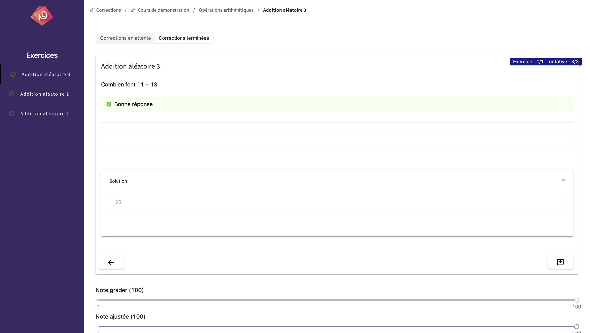

import { Callout, Steps } from 'nextra/components'

# Corriger les copies

PLaTon note automatiquement chaque réponse avec le `grader` de l'exercice. Pour une activité évaluée, des enseignants
peuvent en plus **relire et corriger** les copies : ajuster la note, appliquer des critères d'évaluation (étiquettes) et
laisser des commentaires aux étudiants.

## Qui corrige ?

Une activité est corrigée manuellement dès qu'elle a au moins un **correcteur** :

- à la création d'un **TP noté / Examen**, tous les membres du cours ayant un compte enseignant deviennent correcteurs
  (voir [Ajouter des activités](/main/courses/activities#paramètres-dun-tp-noté)) ;
- les correcteurs se gèrent ensuite dans le critère **Correcteurs** des périodes d'accès (voir
  [Onglet Restrictions](/main/courses/activities#onglet-restrictions)).

Une activité sans correcteur est **auto-corrigée** : seule la note du grader compte.

<Callout type="info">
  Un enseignant ne corrige jamais ses propres sessions : seules les copies des autres membres lui sont proposées.
</Callout>

## Quand les copies arrivent-elles ?

Une copie apparaît dans les corrections quand l'étudiant a **terminé** l'activité (bouton de fin d'activité, temps
écoulé, ou arrêt par les règles de sécurité) et qu'il a répondu à l'exercice au moins une fois (ou que l'exercice a
rencontré une erreur d'exécution).

## L'espace « Corrections »

Le menu **Corrections** de la plateforme rassemble les copies qui vous sont attribuées, dans deux onglets :

- **Corrections en attente** : activités contenant des copies à corriger ;
- **Corrections terminées** : activités dont toutes les copies ont été corrigées.

Les activités sont regroupées par cours. Pour chacune, la colonne **Exercices corrigés** indique l'avancement (par
exemple `12 / 30`). Cliquez sur le nom de l'activité pour ouvrir l'interface de correction ; l'icône
**Se rendre sur la page du cours** ouvre le cours.

Les notifications de correction de la plateforme ouvrent directement l'interface de correction du cours concerné.

## Corriger une copie

<Steps>

### Choisir l'exercice et l'étudiant

Le panneau de gauche liste les exercices de l'activité ; une icône indique s'ils sont corrigés. En haut, la liste
déroulante et les flèches permettent de passer d'un étudiant à l'autre.

### Lire la réponse

La partie centrale affiche l'exercice tel que l'étudiant l'a vu, avec sa réponse et le retour du grader. Si
l'étudiant a validé plusieurs fois, vous pouvez parcourir ses tentatives. Si l'exercice demandait un dépôt de fichiers,
le bouton **Tout télécharger** récupère les fichiers déposés.

### Noter

Le cadre de droite affiche la **note attribuée** (sur 100) et l'avancement de la correction (« N évalués sur M »). La
note de départ est par défaut celle donnée par PLaTon ; l'icône d'engrenage permet de partir plutôt de la note
**maximale** ou **minimale**. Appliquez ensuite des étiquettes (voir ci-dessous) pour ajuster la note.

### Commenter

Sous la note, ajoutez si besoin un **commentaire** sur la réponse : l'étudiant le verra en consultant ses résultats.

### Passer à la copie suivante

Passez à l'étudiant suivant avec la flèche droite de la barre d'outils ou du clavier : **la note est enregistrée à ce
moment-là**.

</Steps>

<Callout type="warning">
  La note est enregistrée quand vous passez à la copie suivante. Si vous fermez la page directement, la dernière copie
  consultée n'est pas enregistrée.
</Callout>

## Les étiquettes (critères d'évaluation)

Le cadre **Critères d'évaluations** contient les étiquettes de l'exercice. Une étiquette a un nom, une description, une
couleur et un **effet sur la note** :

| Effet saisi | Signification                                 |
| ----------- | --------------------------------------------- |
| `+10`       | Ajoute 10 points à la note de départ.         |
| `-5`        | Retire 5 points à la note de départ.          |
| `80`        | Fixe la note à 80.                            |

Cliquez sur une étiquette pour l'appliquer à la copie (ou la retirer). La note est recalculée et reste comprise entre
0 et 100. Les étiquettes appliquées sont enregistrées avec la note.

- **Créer une étiquette** : bouton en bas du cadre (nom, description, couleur).
- Une étiquette peut être ajoutée aux **favoris** pour être réutilisée dans d'autres exercices.

## Le résumé

Le bouton **Résumé** affiche toutes les copies corrigées de l'exercice, avec la note du grader, la note corrigée et les
étiquettes appliquées, ainsi que la moyenne et l'écart type. Il s'ouvre automatiquement quand vous avez corrigé la
dernière copie.

## Raccourcis clavier

| Touche                    | Action                                                         |
| ------------------------- | -------------------------------------------------------------- |
| `→`                       | Enregistrer et passer à l'étudiant suivant                     |
| `Maj` + `→`               | Enregistrer et passer à la prochaine copie contenant une réponse |
| `←`                       | Étudiant précédent (ou quitter le résumé)                      |
| `↑` / `↓`                 | Exercice précédent / suivant                                   |
| `1` à `9`                 | Appliquer l'étiquette correspondante                           |

Les raccourcis sont inactifs lorsque le curseur est dans un champ de saisie.

## Effet sur les notes

- La note corrigée **remplace** la note du grader de l'exercice dans les résultats, les statistiques et l'export CSV.
- Tant que toutes les copies d'un étudiant ne sont pas corrigées, sa note d'activité est considérée comme « en cours de
  correction » (elle apparaît à `-1` dans l'export CSV).
- Quand tous les exercices d'un étudiant sont corrigés, sa **note d'activité** devient la moyenne des notes corrigées
  et il reçoit une notification.

## Consulter une copie sans la corriger

Depuis le tableau **Résultats par apprenants** (statistiques ou suivi de l'activité), un enseignant peut ouvrir la
session d'un étudiant en **visualisation** : il voit les réponses, le nombre d'essais et les commentaires, sans pouvoir
modifier la note.
