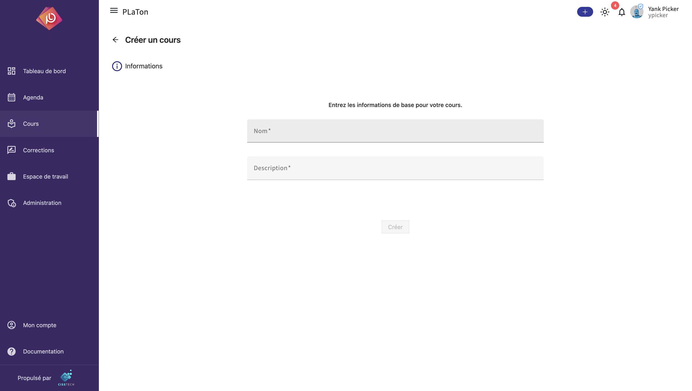
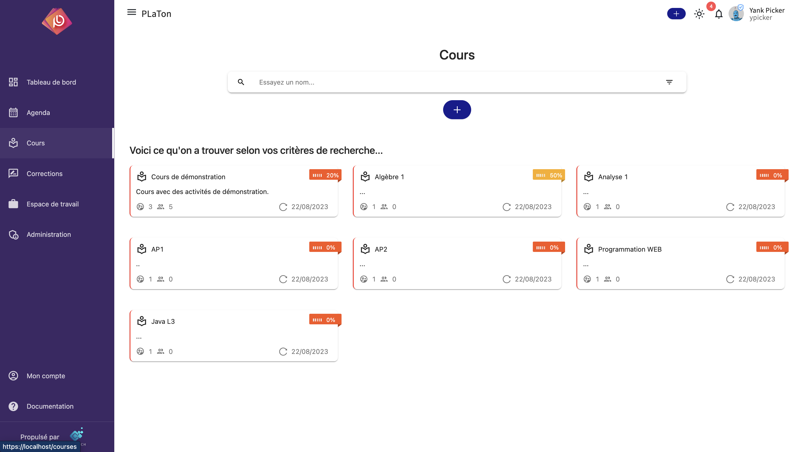
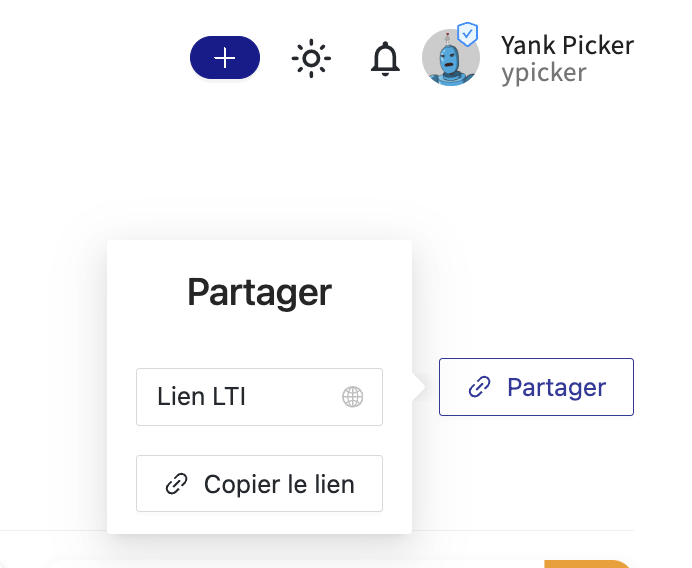

import { Callout, Steps } from 'nextra/components'

# Création d'un cours

Un cours regroupe des [sections](/main/courses/sections), des [activités](/main/courses/activities) et des
[membres](/main/courses/members). Cette page explique comment créer un cours puis comment le retrouver dans la page
**Cours**.

<Callout type="info">
  La création d'un cours est réservée aux comptes **enseignant** et **administrateur**. Le bouton de création n'est pas
  affiché pour les comptes étudiants.
</Callout>

## Créer un cours

<Steps>

### Ouvrir la page des cours

Dans le menu latéral, ouvrez la page **Cours**.

### Lancer la création

Cliquez sur le bouton rond **+** situé à droite de la barre de recherche (info-bulle « Créer un nouveau cours »).

### Renseigner les informations

L'étape **Informations** demande deux champs, tous deux obligatoires :

| Champ           | Rôle                                                                 |
| --------------- | -------------------------------------------------------------------- |
| **Nom**         | Titre du cours, affiché dans la liste des cours et en haut du cours. |
| **Description** | Texte de présentation affiché sous le titre du cours.                |

### Valider

Cliquez sur **Créer**. Vous êtes redirigé vers la page du nouveau cours.

</Steps>

À la création, PLaTon effectue automatiquement deux opérations :

- une première section nommée « Section 1 » est ajoutée au cours ;
- vous devenez **propriétaire** du cours et vous en êtes membre avec le rôle **Enseignant**.

Le nom et la description peuvent être modifiés par la suite, soit en cliquant directement sur le texte en haut de la
page du cours, soit depuis l'onglet [Paramètres](/main/courses/settings).

## Et ensuite ?

Un cours fraîchement créé est vide. Les étapes habituelles sont les suivantes :

1. [Organiser le cours en sections](/main/courses/sections).
2. [Ajouter des activités](/main/courses/activities) dans les sections.
3. [Ajouter des membres](/main/courses/members) ou [partager le cours](#partager-un-cours) pour que les étudiants le
   rejoignent.
4. Éventuellement, [créer des groupes](/main/courses/groups) pour différencier les accès ou filtrer les notes.

<Callout type="info">
  Pour repartir d'un cours existant (par exemple celui de l'année précédente), créez d'abord un cours vide puis
  utilisez **Charger un cours** dans ses [paramètres](/main/courses/settings) : les sections et les activités du cours
  choisi y sont recopiées.
</Callout>

## Retrouver ses cours

La page **Cours** liste les cours dont vous êtes membre. Chaque ligne affiche le nom et la description du cours, le
nombre d'enseignants, d'élèves et d'activités, la date de dernière mise à jour, ainsi que votre avancement sur les
activités (ruban en haut à droite). Une icône de trophée apparaît à côté du nom lorsque le cours contient des
[challenges](/main/courses/challenges).

### Rechercher et trier

- La **barre de recherche** filtre les cours par nom.
- Le bouton de filtre de la barre de recherche ouvre le panneau **Recherche avancée**, qui propose :

| Option                 | Valeurs                                                                                                                        |
| ---------------------- | ------------------------------------------------------------------------------------------------------------------------------ |
| Tri                    | Nom de A à Z, Nom de Z à A, Création (récent vers ancien ou l'inverse), Mise à jour (récente vers ancienne ou l'inverse)        |
| Période de mise à jour | Tout, 1 jour, 1 semaine, 1 mois, 6 mois, 1 an                                                                                  |

Par défaut, les cours sont triés par date de mise à jour, du plus récent au plus ancien. Le tri choisi est mémorisé
dans votre navigateur et réappliqué à votre prochaine visite.

### Archiver un cours

Les cours des années passées peuvent être retirés de la liste principale sans être supprimés.

- Dans l'onglet **Cours actuels**, cliquez sur l'icône d'archivage à droite de la ligne du cours (info-bulle
  « Archiver ce cours »). Le cours passe dans l'onglet **Cours archivés**.
- Dans l'onglet **Cours archivés**, la même icône (info-bulle « Désarchiver ce cours ») le replace dans les cours
  actuels.

L'archivage est **personnel** : il ne concerne que votre propre liste. Le cours reste inchangé et pleinement
accessible pour les autres membres, étudiants comme enseignants. Tout membre peut archiver un cours, quel que soit son
rôle.

<Callout type="warning">
  L'archivage n'est possible que si vous avez été ajouté au cours **individuellement**. Si vous n'êtes membre du cours
  qu'à travers un groupe d'utilisateurs, l'archivage échoue.
</Callout>

### Cas des administrateurs

Pour un administrateur, la liste n'affiche par défaut que les cours dont il est membre. Le bouton
**Afficher tous les cours** (onglet « Cours actuels ») charge l'ensemble des cours de la plateforme. Le bouton
d'archivage n'est pas proposé aux administrateurs.

## Partager un cours

Les enseignants du cours disposent d'un bouton **Partager** en haut à droite de la page du cours. Il permet de copier
un lien vers le cours, sous deux formes :

| Type de lien    | Usage                                                                                                                                                                                              |
| --------------- | -------------------------------------------------------------------------------------------------------------------------------------------------------------------------------------------------- |
| **Lien LTI**    | À utiliser dans une plateforme compatible LTI (Moodle par exemple). L'utilisateur est connecté automatiquement à PLaTon, ajouté aux membres du cours s'il ne l'est pas encore, puis redirigé vers le cours. Voir [Intégration LTI](/main/users/lti-integration). |
| **Lien PLaTon** | Lien direct vers la page du cours, utilisable uniquement par des utilisateurs déjà connectés à PLaTon.                                                                                              |

Choisissez le type de lien dans la liste déroulante puis cliquez sur **Copier le lien**.

<Callout type="warning">
  Le **Lien PLaTon** ne donne pas accès au cours à lui seul : un utilisateur qui n'est pas membre du cours obtient une
  erreur d'accès. Ajoutez-le d'abord aux [membres du cours](/main/courses/members). Pour faire découvrir un cours à des
  personnes sans compte, utilisez plutôt un [accès démo](/main/courses/demo).
</Callout>
