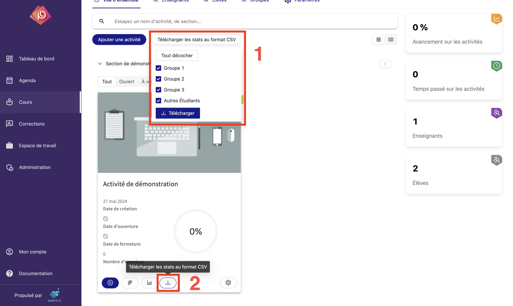

import { Callout } from 'nextra/components'

# Téléchargement des notes

Les enseignants d'un cours peuvent télécharger les notes des étudiants dans un fichier CSV, pour les reporter dans un
tableur ou un logiciel de scolarité.



## Où trouver le bouton

- **Notes de tout le cours** : bouton **Télécharger les notes au format CSV** en haut de l'onglet
  **Vue d'ensemble** du cours *(bouton **1** sur l'image)*. Le fichier contient toutes les activités du cours.
- **Notes d'une activité** : menu ⋮ de la carte de l'activité, entrée **Télécharger les notes au format CSV**
  *(bouton **2** sur l'image)*.

## Filtrer par groupe

Si le cours contient des [groupes](/main/courses/groups), le bouton ouvre une liste de cases à cocher :

- une case par groupe du cours (pour une activité dont l'accès est restreint à certains groupes, seuls ces groupes
  sont proposés) ;
- une case **Autres étudiants** pour les étudiants qui ne font partie d'aucun des groupes proposés ;
- **Tout cocher** / **Tout décocher** pour aller plus vite.

Cliquez ensuite sur **Télécharger**. Sans groupe dans le cours, le téléchargement démarre directement.

## Contenu du fichier

Le fichier s'appelle `<nom>_results.csv` et utilise le **point-virgule** comme séparateur.

| Colonne                              | Contenu                                                                                         |
| ------------------------------------ | ----------------------------------------------------------------------------------------------- |
| `username`                           | Identifiant de l'étudiant.                                                                      |
| `firstname`, `lastname`, `email`     | Prénom, nom et adresse e-mail.                                                                  |
| `"(Activité) Exercice"`              | Une colonne par exercice, nommée d'après l'activité et l'exercice, contenant la note sur 100.  |
| `TOTAL`                              | Formule de tableur qui additionne les notes de la ligne (`=SUM(...)`).                          |

Valeur d'une cellule de note :

| Valeur        | Signification                                                                  |
| ------------- | ------------------------------------------------------------------------------ |
| *(vide)*      | Exercice non commencé.                                                         |
| un nombre     | Meilleure note obtenue ; la note corrigée si l'exercice a été [corrigé](/main/courses/corrections). |
| `-1`          | Exercice d'une activité en attente de correction, ou commencé sans note.       |
| `ERROR`       | L'exécution de l'exercice a échoué.                                            |

```csv
username;firstname;lastname;email;"(TP 1) Boucles";"(TP 1) Listes";TOTAL
jdupont;Jeanne;Dupont;jeanne.dupont@exemple.fr;100;75;=SUM(E2:F2)
```

<Callout type="info">
  La colonne `TOTAL` est une **formule** : elle n'est calculée qu'à l'ouverture dans un tableur (LibreOffice Calc,
  Excel…). Selon les réglages de votre tableur, choisissez le point-virgule comme séparateur à l'import.
</Callout>

<Callout type="warning">
  Les notes reflètent l'état au moment du téléchargement. Pour une activité corrigée manuellement, attendez la fin des
  corrections avant d'exporter : les copies non corrigées apparaissent à `-1`.
</Callout>
