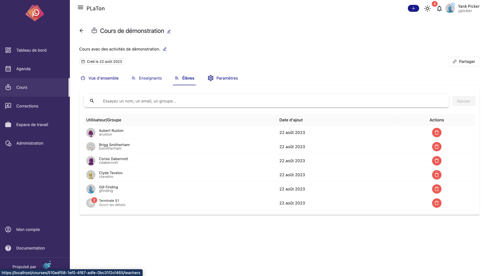

import { Callout, Steps } from 'nextra/components'

# Gestion des membres d'un cours

Les membres d'un cours sont les personnes qui y ont accès. Chaque membre a l'un des deux rôles suivants :

| Rôle           | Ce qu'il permet                                                                                                                                                                       |
| -------------- | ------------------------------------------------------------------------------------------------------------------------------------------------------------------------------------- |
| **Étudiant**   | Voir les sections et activités visibles, réaliser les activités ouvertes et consulter ses résultats.                                                                                 |
| **Enseignant** | Tout ce que peut faire un étudiant, plus la gestion du cours : sections, activités, membres, groupes, paramètres, suivi et statistiques. Un enseignant peut aussi être désigné correcteur d'une activité. |

L'onglet **Membres** de la page du cours affiche la liste des membres avec, pour chacun, le nom de l'utilisateur ou
du groupe, la date d'ajout et le rôle. Une barre de recherche permet de filtrer la liste par nom ou adresse e-mail.

## Ajouter des membres

<Steps>

### Ouvrir la fenêtre d'ajout

Dans l'onglet **Membres**, cliquez sur **Ajouter un membre** (bouton réservé aux enseignants du cours).

### Choisir le rôle

En haut de la fenêtre, choisissez **Étudiants** ou **Enseignants** dans la liste déroulante « Sélectionnez les … que
vous souhaitez ajouter ».

### Sélectionner les utilisateurs

Recherchez les utilisateurs par leur nom, puis sélectionnez-les. Pour le rôle **Étudiant**, vous pouvez aussi
sélectionner un **groupe d'utilisateurs** de la plateforme (voir [Groupes d'utilisateurs](/main/users/groups)) : tous
ses membres accèdent alors au cours. Les personnes déjà membres n'apparaissent pas dans la recherche.

### Valider

Cliquez sur **Ajouter**. Les nouveaux membres reçoivent une notification les informant de leur inscription.

</Steps>

<Callout type="warning">
  Seuls les utilisateurs ayant un compte **enseignant** ou **administrateur** peuvent être ajoutés avec le rôle
  Enseignant. De même, un groupe d'utilisateurs ne peut recevoir le rôle Enseignant que s'il est composé uniquement
  d'enseignants.
</Callout>

### Inscription automatique

Il n'est pas toujours nécessaire d'inscrire les étudiants à la main :

- un utilisateur qui suit le **lien LTI** du cours depuis un LMS est inscrit automatiquement comme étudiant
  (voir [Partager un cours](/main/courses/create#partager-un-cours)) ;
- un utilisateur qui ouvre le lien d'**accès démo** est inscrit comme étudiant (voir [Accès démo](/main/courses/demo)).

## Changer le rôle d'un membre

Dans la colonne **Rôle**, choisissez **Étudiant** ou **Enseignant** dans la liste déroulante. Le passage au rôle
Enseignant est refusé si l'utilisateur n'a pas un compte enseignant ou administrateur.

## Retirer un membre

Cliquez sur l'icône de corbeille de la ligne puis confirmez. Le membre perd l'accès au cours. Le **propriétaire**
du cours (son créateur) ne peut pas être retiré.

<Callout type="info">
  Retirer un **groupe d'utilisateurs** retire l'accès à tous ses membres qui n'ont pas été ajoutés individuellement.
</Callout>

## Membres et groupes de cours

Ne confondez pas :

- les **groupes d'utilisateurs** de la plateforme, gérés par les administrateurs et que l'on peut inscrire en bloc à
  un cours ;
- les **groupes de cours**, créés dans l'onglet [Groupes](/main/courses/groups) pour répartir les étudiants d'un cours
  (TD, TP…) et leur ouvrir des activités à des dates différentes.
