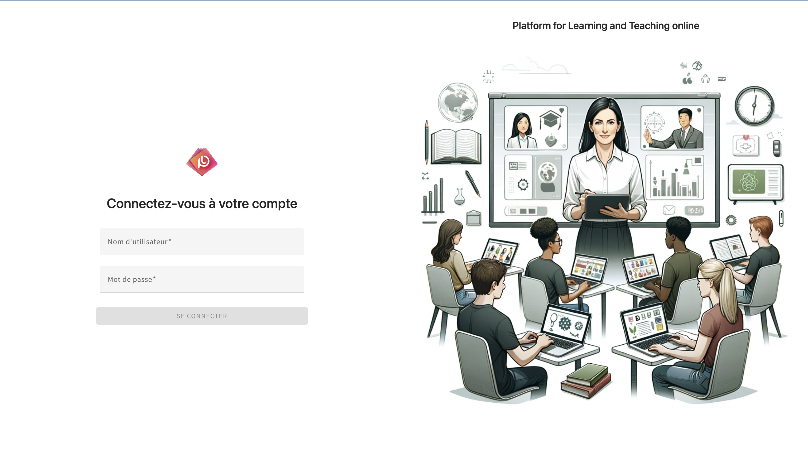

import { Callout } from 'nextra/components'

# Connexion à la plateforme

PLaTon propose plusieurs façons de se connecter. La page de connexion s'affiche automatiquement lorsque vous ouvrez
PLaTon sans être connecté.

## Les modes de connexion

| Mode                                 | Pour qui                                                                 | Comment                                                                                                                                       |
| ------------------------------------ | ------------------------------------------------------------------------ | --------------------------------------------------------------------------------------------------------------------------------------------- |
| **Depuis votre LMS (Moodle…)**       | Étudiants et enseignants dont l'établissement a relié PLaTon à son LMS  | Cliquez sur le lien PLaTon placé dans un cours du LMS : vous êtes connecté automatiquement et votre compte est créé lors de la première visite. |
| **Nom d'utilisateur et mot de passe**| Utilisateurs qui ont un mot de passe PLaTon                              | Remplissez **Nom d'utilisateur** et **Mot de passe** sur la page de connexion.                                                                |
| **CAS**                              | Établissements qui ont déclaré un serveur CAS                            | Cliquez sur le bouton CAS de votre établissement, sous le formulaire de connexion.                                                            |
| **Lien d'accès démo**                | Personnes invitées à découvrir un cours                                  | Ouvrez le lien fourni par l'enseignant : un compte temporaire est créé (voir [Accès démo](/main/courses/demo)).                              |
| **Lien d'invitation à un test**      | Candidats à un test d'entrée                                             | Ouvrez le lien reçu par e-mail (voir [Tests d'entrée](/main/courses/tests)).                                                                   |

## Première connexion, étape par étape

### Vous êtes à l'Université Gustave Eiffel

1. Connectez-vous à [E-learning](https://elearning.univ-eiffel.fr/) avec vos identifiants de l'université.
2. Ouvrez un cours qui contient un lien PLaTon (votre enseignant vous l'indique) et cliquez sur ce lien.
3. PLaTon s'ouvre : votre compte est créé et vous êtes connecté. Si le lien vise un cours PLaTon, vous y êtes
   inscrit automatiquement.
4. Facultatif : pour pouvoir vous connecter ensuite directement à PLaTon, définissez un mot de passe dans
   **Mon compte** › **Sécurité** (voir [Profil utilisateur](/main/users/profile)).

<Callout type="info">
  **Enseignants** : votre compte est créé avec le rôle enseignant si vous êtes enseignant dans le cours du LMS d'où
  vous venez. Si votre compte a été créé comme étudiant, il sera promu enseignant dès que vous ouvrirez PLaTon depuis un
  cours où vous enseignez.
</Callout>

### Vous êtes extérieur à l'Université Gustave Eiffel

Un administrateur de PLaTon doit vous créer un compte. Contactez Dominique Revuz par mail :
[dominique.revuz@univ-eiffel.fr](mailto:dominique.revuz@univ-eiffel.fr).

## En cas de problème

| Situation                                                     | Que faire                                                                                                                                  |
| ------------------------------------------------------------- | ------------------------------------------------------------------------------------------------------------------------------------------ |
| « Une erreur est survenue lors de la connexion ! »            | Vérifiez votre nom d'utilisateur et votre mot de passe. Si votre compte a été créé par votre LMS et que vous n'avez jamais défini de mot de passe, passez par le lien du LMS. |
| Vous ne connaissez pas votre nom d'utilisateur                | Continuez à vous connecter depuis votre LMS, ou demandez-le à un administrateur de la plateforme.                                         |
| Le lien du LMS mène à une page « cours introuvable »          | Le cours PLaTon n'a pas encore été créé par l'enseignant : prévenez-le (voir [Intégration LTI](/main/users/lti-integration)).              |
| Vous êtes déconnecté pendant votre travail                    | Votre session a expiré : reconnectez-vous, ou rouvrez le lien depuis votre LMS.                                                           |
| Vous n'avez pas de compte                                     | Le lien **Vous n'avez pas de compte sur PLaTon ?** de la page de connexion mène à cette page.                                              |
