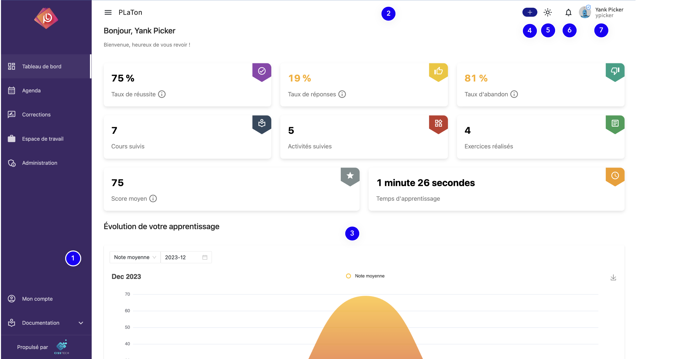

# Navigation dans l'interface

PLaTon est conçu comme une application web intuitive, adoptant une structure d'interface utilisateur commune à de nombreuses applications modernes. L'interface est organisée en trois sections principales pour une navigation fluide et une interaction efficace.

## 1. La navigation

La barre de navigation est constamment présente sur le côté gauche de l'écran dans toutes les pages de PLaTon. Elle facilite la navigation entre les différentes sections de l'application, affichant uniquement les pages auxquelles vous avez accès en fonction de votre type de compte. Les options incluent :

- **Tableau de bord** : la page d'accueil, avec vos statistiques et, pour les enseignants, les modèles d'exercices
  (voir [apprenant](/main/dashboard/student) et [enseignant](/main/dashboard/teacher)).
- **Annonces** : les messages publiés par les administrateurs de la plateforme.
- **Cours** : vos cours (voir [Gestion des cours](/main/courses/overview)).
- **Corrections** : les copies qui vous sont attribuées (voir [Corriger les copies](/main/courses/corrections)).
- **Espace de travail** *(enseignants et administrateurs)* : création et recherche de
  [ressources](/main/resources/types).
- **Tests d'entrée** *(enseignants et administrateurs)* : tests passés par des candidats (voir
  [Tests d'entrée](/main/courses/tests)).
- **Administration** *(administrateurs)* : gestion de la plateforme (voir
  [Tableau de bord administrateur](/main/dashboard/admin)).
- **Documentation** *(enseignants et administrateurs)* : ouvre cette documentation.

Sur petit écran, le menu se replie : le bouton en haut à gauche l'affiche ou le masque.

## 2. La barre de menu

Située en haut de l'écran, la barre de menu est accessible sur toutes les pages de PLaTon. Elle propose des raccourcis pour des actions rapides et fréquentes, symbolisées par des icônes :

- **Tutoriels** *(enseignants et administrateurs)* : lance une visite guidée de l'interface.
- **Création (4)** : Permet de créer rapidement un cours, un cercle, une activité ou un exercice (selon vos droits).
- **Thème (5)** : Choisit le thème clair, le thème sombre ou le thème du système.
- **Notifications (6)** : Affiche les notifications reçues sur PLaTon.
- **Menu Utilisateur (7)** : Un menu déroulant donnant accès à :
  - **Mon compte** : Pour accéder à votre [profil](/main/users/profile).
  - **Mon cercle** *(enseignants et administrateurs)* : votre [cercle personnel](/main/resources/circles).
  - **Déconnexion** : Pour se déconnecter de PLaTon.

## 3. Le contenu

La partie centrale de l'interface, le contenu, affiche les informations relatives à la page actuelle. Cette zone s'adapte en fonction de la section sélectionnée dans la navigation, affichant les détails pertinents des cours, des exercices ou toute autre information en rapport avec la section choisie.
