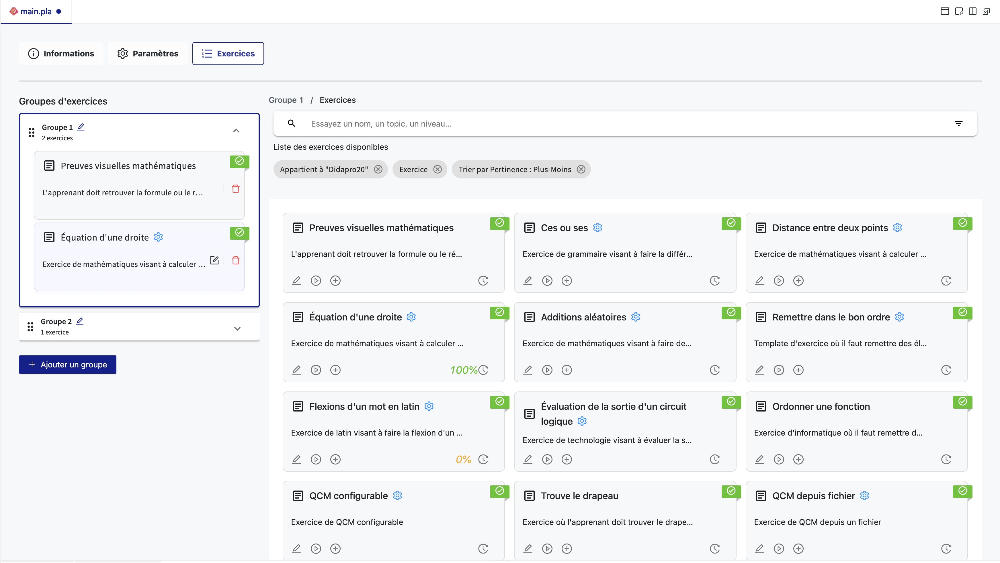

import { Callout } from 'nextra/components'

# Ajout d'exercices à une activité

Les exercices d'une activité sont rangés dans des **groupes d'exercices**, dans l'onglet de l'éditeur de `main.pla`
consacré aux exercices.

## Créer des groupes

- **Ajouter un groupe** crée un nouveau groupe, nommé automatiquement selon son rang. Vous pouvez le renommer.
- Les groupes peuvent être réordonnés par glisser-déposer et supprimés avec l'icône de corbeille.
- Cliquez sur un groupe pour le sélectionner : c'est dans ce groupe que seront ajoutés les exercices.

## Ajouter des exercices

- La barre de recherche trouve les exercices de la plateforme ; par défaut, elle affiche les exercices du cercle dans
  lequel vous créez l'activité. Le bouton de filtre ouvre la [recherche avancée](/main/resources/search).
- Ajoutez un exercice au groupe sélectionné avec le bouton **+** (**Ajouter l'exercice au groupe**), ou faites-le
  glisser dans un groupe.
- Chaque carte de résultat indique la note moyenne obtenue par les apprenants et le nombre d'utilisations de
  l'exercice, ainsi que sa date de mise à jour. Les boutons **Éditer** et **Prévisualiser** ouvrent l'exercice.

## Paramétrer un exercice configurable

Un exercice **configurable** (créé à partir d'un modèle, ou possédant un `main.plc`) expose des variables
personnalisables. Dans le groupe, **Afficher les variables** déplie la liste des variables ; **Editer** ouvre le champ
d'une variable. Les valeurs saisies ne s'appliquent qu'à **cette activité** : l'exercice d'origine n'est pas modifié.
La prévisualisation de l'exercice dans l'activité utilise ces valeurs.

<Callout type="info">
  Une carte **Exercice privé** signale un exercice que vous n'avez plus le droit de lire (par exemple déplacé dans un
  cercle personnel). Une carte **Erreur** signale un exercice qui n'a pas pu être chargé. Dans les deux cas, vous
  pouvez retirer l'exercice du groupe.
</Callout>

## À quoi servent les groupes ?

Le rôle des groupes dépend du [mode de navigation](/main/programing/activity/config) de l'activité :

| Mode                                     | Rôle des groupes                                                                                                                                                                          |
| ---------------------------------------- | ----------------------------------------------------------------------------------------------------------------------------------------------------------------------------------------- |
| **Progressive** et **Composée**          | Organisation pour l'enseignant uniquement : l'apprenant reçoit **tous** les exercices de tous les groupes, dans l'ordre des groupes puis des exercices. Les noms des groupes ne lui sont pas affichés. |
| **Validation**                           | Chaque groupe est une étape à valider (note minimale, nombre d'exercices, tentatives…). Voir [Navigation par validation](/main/programing/activity/next-navigation/validation).            |
| **Intelligente**                         | Les groupes sont accessibles depuis le script `next` pour choisir les exercices. Voir [Navigation intelligente](/main/programing/activity/next-navigation/next).                           |
| **Comparaison par les pairs**            | Les groupes doivent porter des noms précis. Voir [Évaluation par les pairs](/main/programing/activity/peer).                                                                              |

<Callout type="warning">
  En mode Progressive ou Composée, les exercices ne sont **pas mélangés** et les titres des groupes ne sont pas visibles
  par les apprenants. Pour présenter des parties à l'apprenant, utilisez l'introduction de l'activité ou l'énoncé des
  exercices.
</Callout>

## Après la publication de l'activité

Les cours qui utilisent l'activité gardent la version qu'ils ont ajoutée. Après avoir modifié les exercices ou les
groupes, utilisez **Recharger** dans les paramètres de l'activité de cours pour mettre à jour les cours (voir
[Recharger une activité](/main/courses/activities#recharger-une-activité)).
