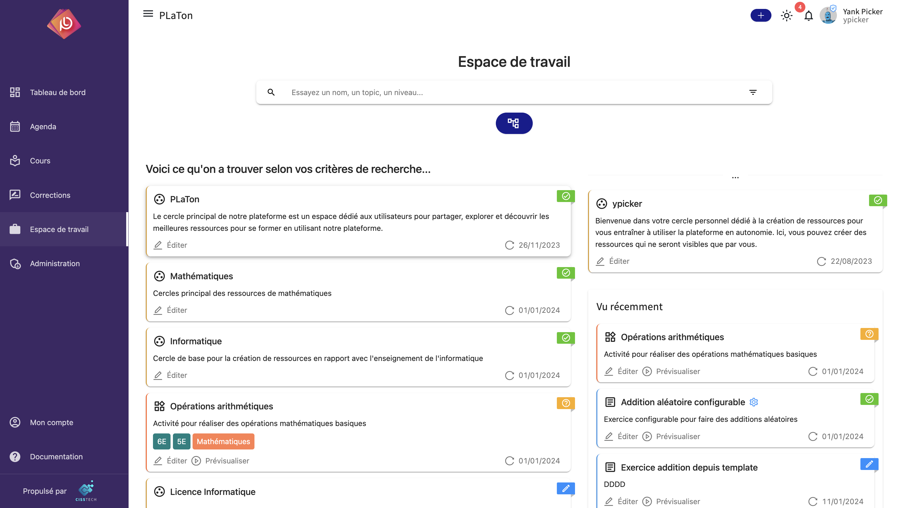

import { Callout } from 'nextra/components'

# Recherche de ressources

La page **Espace de travail** (menu latéral, réservé aux enseignants et administrateurs) permet de rechercher les
ressources de la plateforme : cercles, activités et exercices.

## La recherche par mots-clés

Saisissez un mot dans la barre de recherche : PLaTon affiche les ressources dont le **nom**, un **topic** ou un
**niveau** contient ce texte. La recherche ne tient compte ni des majuscules ni des accents. Pendant la saisie, des
suggestions de noms, de topics et de niveaux sont proposées.

Les critères actifs apparaissent sous forme d'étiquettes au-dessus des résultats ; cliquez sur la croix d'une étiquette
pour retirer le critère. Les résultats se chargent au fur et à mesure du défilement.

## La recherche avancée

L'icône de filtre de la barre de recherche ouvre le panneau **Recherche avancée**. Validez avec **Appliquer**.

| Critère                                         | Effet                                                                                                  |
| ----------------------------------------------- | ------------------------------------------------------------------------------------------------------ |
| **Qu'est-ce que vous recherchez ?**             | Types de ressources : cercles, activités, exercices.                                                    |
| **Appliquer des filtres aux exercices ?**       | **Configurable** : uniquement les exercices configurables (modèles).                                    |
| **Quel est son statut ?**                       | Statuts acceptés (voir le tableau ci-dessous).                                                          |
| **Elle appartient aux cercles ?**               | Uniquement les ressources de ces cercles.                                                               |
| **Elle possède des topics ?**                   | Ressources ayant au moins un des topics choisis.                                                        |
| **Elle ne possède pas des topics ?**            | **Exclut** les ressources ayant l'un de ces topics.                                                     |
| **Elle possède des niveaux ?**                  | Ressources ayant au moins un des niveaux choisis.                                                       |
| **Elle appartient à un utilisateur ?**          | Ressources créées par les utilisateurs choisis.                                                         |
| **Tri**                                         | Nom (A→Z, Z→A), date de création, date de mise à jour ou **pertinence**.                               |
| **Limiter à une certaine période de mise à jour ?** | Ressources modifiées dans le dernier jour, la dernière semaine, le dernier mois, les 6 derniers mois ou la dernière année. |

Les statuts possibles d'une ressource :

| Statut                         | Signification                                    |
| ------------------------------ | ------------------------------------------------ |
| **Brouillon**                  | En cours d'écriture.                             |
| **Prêt à l'utilisation**       | Testé et utilisable dans des cours.              |
| **Besoin d'être testé**        | Terminé mais pas encore vérifié.                 |
| **Contient des bugs**          | Problème connu.                                  |
| **Ne pas utiliser**            | Obsolète.                                        |

<Callout type="info">
  Le **tri par pertinence** met en avant les ressources souvent utilisées, récemment mises à jour et au statut
  « Prêt à l'utilisation ».
</Callout>

## Les autres outils de la page

- **Arbre des cercles** : le bouton à droite de la barre de recherche affiche l'arborescence des cercles, pour
  naviguer d'un cercle à l'autre.
- **Mon espace** (colonne de droite) : accès direct à votre [cercle personnel](/main/resources/circles).
- **Vu récemment** : les dernières ressources que vous avez consultées.

<Callout type="info">
  Les cercles personnels des autres utilisateurs n'apparaissent pas dans les résultats, sauf si vous en êtes membre
  (voir [Gestion des droits](/main/resources/permissions)).
</Callout>
