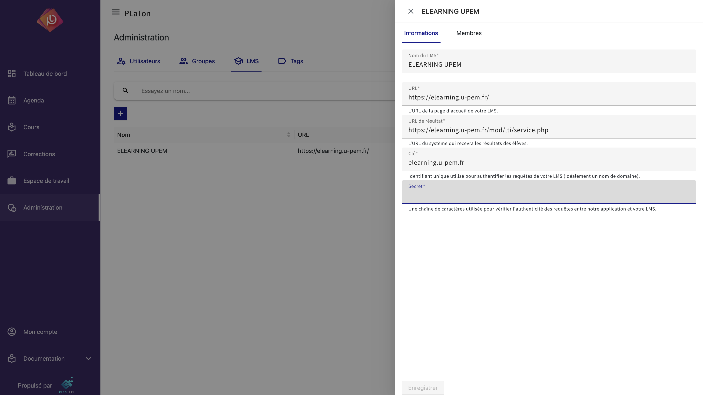
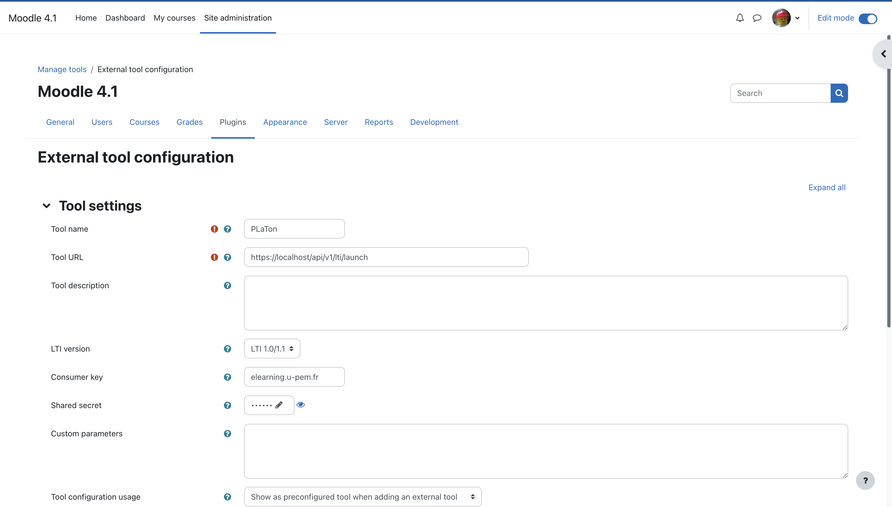
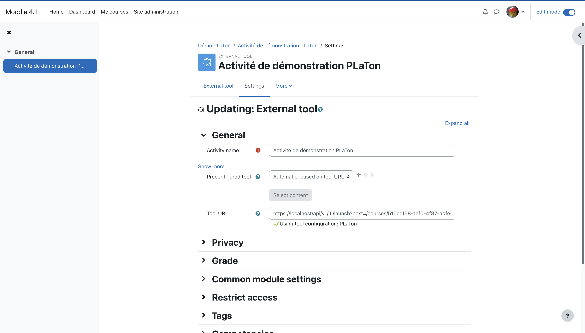

import { Callout, Steps } from 'nextra/components'

# Intégration LTI

[LTI (Learning Tools Interoperability)](https://www.1edtech.org/standards/lti) est une norme qui permet à un LMS
(Moodle, Canvas, Blackboard…) d'ouvrir un outil externe en y connectant automatiquement l'utilisateur. PLaTon est un
**outil LTI** : depuis un lien placé dans leur cours Moodle, enseignants et étudiants arrivent dans PLaTon sans saisir
d'identifiant.

PLaTon prend en charge **LTI 1.3** (recommandé) et **LTI 1.1** (obsolète, conservé pour les installations
existantes). La configuration se fait dans **Administration** › **LMS** et est réservée aux administrateurs.

## LTI 1.3

### 1. Déclarer PLaTon dans le LMS

L'onglet **LTI 1.3** de **Administration** › **LMS** affiche les adresses à renseigner dans le LMS lors de la
déclaration de l'outil :

| Champ affiché par PLaTon                         | Valeur                                    |
| ------------------------------------------------ | ----------------------------------------- |
| **URL de connexion (login initiation)**          | `https://<votre-plateforme>/lti/login`    |
| **URL de redirection / de lancement (launch)**   | `https://<votre-plateforme>/lti/launch`   |
| **URL du JWKS (clés publiques)**                 | `https://<votre-plateforme>/lti/keys`     |

L'enregistrement dynamique n'est pas proposé : la plateforme doit être déclarée manuellement des deux côtés.

### 2. Déclarer le LMS dans PLaTon

<Steps>

### Ajouter une plateforme

Dans l'onglet **LTI 1.3**, cliquez sur le bouton d'ajout (**Ajouter une plateforme LTI 1.3**).

### Renseigner les informations fournies par le LMS

| Champ                                   | Contenu                                                                                                       |
| --------------------------------------- | ------------------------------------------------------------------------------------------------------------- |
| **Reprendre un LMS LTI 1.1** (optionnel) | LMS déjà déclaré en LTI 1.1 que cette plateforme remplace : les comptes et les cours déjà créés via LTI 1.1 sont conservés. |
| **Nom**                                 | Nom de la plateforme dans PLaTon.                                                                              |
| **Issuer (URL de la plateforme)**       | Valeur du champ « iss » envoyée par le LMS (par exemple `https://moodle.exemple.fr`).                         |
| **Client ID**                           | Identifiant du client généré par le LMS lors de la déclaration de l'outil.                                    |
| **URL d'authentification**              | URL d'authentification OIDC du LMS.                                                                            |
| **URL du jeton d'accès**                | URL de délivrance des jetons du LMS.                                                                           |
| **Serveur d'autorisation** (optionnel)  | Si le LMS en indique un.                                                                                       |
| **URL du JWKS de la plateforme**        | Utilisée pour vérifier la signature des lancements envoyés par le LMS.                                        |
| **Plateforme active**                   | Désactivez-la pour refuser temporairement les lancements de ce LMS.                                            |

### Enregistrer

La plateforme apparaît dans le tableau ; elle peut y être modifiée ou supprimée.

</Steps>

<Callout type="warning">
  Si votre établissement utilisait PLaTon en LTI 1.1, choisissez le LMS correspondant dans **Reprendre un LMS LTI
  1.1**. Sans cela, les utilisateurs arrivant en LTI 1.3 obtiendraient de nouveaux comptes, sans leurs cours ni leurs
  résultats.
</Callout>

### 3. Paramètres personnalisés de l'outil

Dans le LMS, les **paramètres personnalisés** (custom parameters) de l'outil ou d'une activité précisent où mener
l'utilisateur :

| Paramètre   | Effet                                                                                                                                          |
| ----------- | ---------------------------------------------------------------------------------------------------------------------------------------------- |
| `next`      | Page de PLaTon à ouvrir, sous forme de chemin relatif (par exemple `/courses/<id>`). Une adresse vers un autre site est ignorée.               |
| `course`    | Identifiant du cours PLaTon à ouvrir (et dans lequel inscrire l'utilisateur).                                                                  |
| `activity`  | Identifiant d'une activité de ce cours : l'utilisateur est envoyé directement dans l'activité.                                                 |
| `groups`    | Liste de groupes, séparés par des virgules, dans lesquels placer l'utilisateur. Avec Moodle : `groups=$Moodle.Person.userGroupIds`.             |
| `username`  | Identifiant de l'utilisateur dans le LMS, utilisé pour construire son nom d'utilisateur PLaTon. Avec Moodle : `username=$User.username`.      |

Pour relier un lien du LMS à un cours PLaTon précis, indiquez par exemple `course=<identifiant du cours>` ou
`next=/courses/<identifiant du cours>` ; l'identifiant figure dans l'adresse de la page du cours.

<Callout type="info">
  Le **Lien LTI** proposé par le bouton **Partager** d'un cours
  (`…/api/v1/lti/launch?next=/courses/<id>`, voir [Partager un cours](/main/courses/create#partager-un-cours)) est
  au format **LTI 1.1** : il s'utilise comme URL d'outil avec un LMS déclaré en LTI 1.1. En LTI 1.3, l'adresse de
  lancement est toujours la même et la destination passe par les paramètres personnalisés ci-dessus.
</Callout>

## Ce qui se passe au lancement

À chaque lancement depuis le LMS (LTI 1.3) :

1. **Compte** : l'utilisateur est retrouvé grâce à son identifiant dans le LMS, ou un compte PLaTon est créé
   (prénom, nom, e-mail transmis par le LMS). Un utilisateur ayant un rôle d'enseignant dans le LMS reçoit un compte
   **enseignant** ; un compte étudiant existant est promu enseignant si le LMS le désigne comme enseignant.
2. **Cours** :
   - si le lancement vise un cours (`course` ou `next` vers `/courses/<id>`), l'utilisateur y est inscrit ;
   - sinon, PLaTon cherche le cours rattaché au cours du LMS. Si aucun n'existe et que l'utilisateur est
     **enseignant**, un cours PLaTon est **créé automatiquement**, nommé d'après le cours du LMS et rattaché à lui :
     les étudiants qui utiliseront ensuite le même lien y seront inscrits. Un étudiant qui arrive avant cette création
     est envoyé vers une page « cours introuvable ».
3. **Rôle dans le cours** : l'utilisateur est inscrit comme **Enseignant** s'il est enseignant dans le LMS, sinon comme
   **Étudiant**. Si son rôle dans le LMS change, son rôle dans le cours est mis à jour au lancement suivant.
4. **Groupes** : avec le paramètre `groups`, les groupes correspondants sont créés dans le cours PLaTon si besoin et
   l'utilisateur y est ajouté (voir [Gestion des groupes](/main/courses/groups)).
5. **Redirection** : l'utilisateur arrive sur le cours, ou directement dans l'activité indiquée par `activity`.

<Callout type="info">
  Un utilisateur créé par LTI n'a pas de mot de passe PLaTon. Il peut en définir un depuis son profil pour se
  connecter aussi directement (voir [Profil utilisateur](/main/users/profile)).
</Callout>

## LTI 1.1 (obsolète)

L'onglet **LTI 1.1 (obsolète)** de **Administration** › **LMS** gère les LMS déclarés avec l'ancienne version de la
norme. Préférez LTI 1.3 pour toute nouvelle installation, et faites migrer les LMS existants avec **Reprendre un LMS
LTI 1.1**.

### Déclarer un LMS en LTI 1.1

Pour intégrer un LMS avec PLaTon, vous devez fournir les informations suivantes dans l'espace d'administration des LMS :

- **Nom** : Nommez votre intégration LMS pour la distinguer facilement dans PLaTon.
- **URL** : L'adresse URL du LMS avec lequel vous souhaitez intégrer PLaTon.
- **URL de résultat** : Cette URL est utilisée par PLaTon pour renvoyer les informations au LMS, telles que les scores ou les progrès des étudiants.
- **Clé** : Une clé unique fournie par le LMS pour authentifier l'intégration.
- **Secret** : Un secret partagé entre PLaTon et le LMS, utilisé en conjonction avec la clé pour sécuriser la communication.

Ces informations permettent une communication sécurisée entre PLaTon et le LMS, garantissant que les données des utilisateurs sont protégées et que l'interaction entre les deux systèmes est fluide.

### Exemple avec Moodle (LTI 1.1)

Pour vous connecter à PLaTon depuis Moodle :

#### Configuration dans Moodle

- Allez dans la section de gestion des plugins ou modules complémentaires de Moodle.
- Ajoutez un nouvel outil externe en spécifiant l'URL de PLaTon (https://platon.example.com/api/v1/lti/launch), la clé et le secret fournis.
- Pour plus de détails sur la configuration de l'outil externe dans Moodle, consultez [la documentation Moodle](https://docs.moodle.org/403/en/LTI_External_tools) :

#### Utilisation par les enseignants et les étudiants

- Une fois configuré par un adminstrateur Moodle, les enseignants peuvent ajouter l'outil externe à leurs cours Moodle en suivant les instructions [ici](https://docs.moodle.org/403/en/External_tool_settings).
- Définissez `Preconfigured tool` sur `Automatic, based on launch URL` et entrez `https://platon.example.com/api/v1/lti/launch?next=PAGE_URL` dans le champ Tool URL (en remplaçant `PAGE_URL` par l'URL de la page de destination dans PLaTon).
- Lorsque les enseignants et les étudiants cliquent sur le lien de l'outil externe dans leur cours Moodle, ils sont automatiquement redirigés et connectés à PLaTon, les emmenant directement à la page spécifiée après next=.
- Si la page cible est un cours, ils seront inscrits automatiquement dans le cours sur PLaTon.

<Callout type="info">
  Les cours dans PLaTon intègrent un bouton partage qui permet aux enseignants de générer un lien direct vers la page de
  destination dans PLaTon. Ce lien peut être utilisé pour configurer l'outil externe dans Moodle. 
</Callout>
